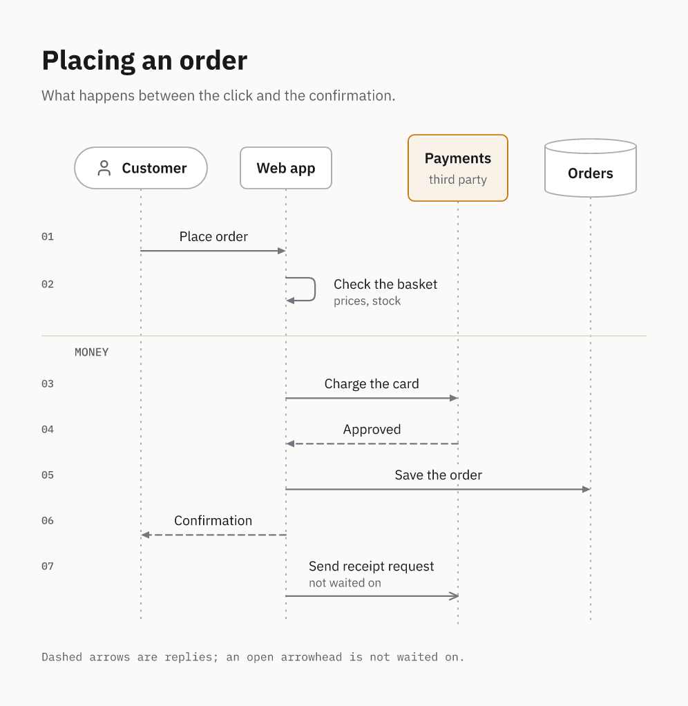

# diagram-compiler

A Claude Code plugin that draws technical diagrams, checks them against the code they describe, and keeps them
current as the code changes.

Claude writes a short description of what to draw: the boxes, the arrows and the words, never a position. A program
lays it out, draws it and checks it. On a given machine, the same description always produces the same file.



## What it does

- **Six diagram types.** Flow (boxes and arrows), sequence (who calls whom, in order), table, grid of panels, tree
  and mind map. Output is SVG and PNG, light or dark.
- **A checker.** Overlaps, cut-off text, crossings, long detours, labels on the wrong arrow and bad page shapes are
  reported with the change to make.
- **A source check.** Any box, arrow, row or step can cite a file, a line and a few quoted words. `diagram verify`
  confirms the file exists, the line exists and the words are there.
- **Incremental updates.** A checked diagram is stamped with the state of the repository. After the code changes,
  `diagram stale` sorts every citation into untouched, repaired without reading, or to be read again, with the exact
  line ranges. Claude reads only those.

## Install

Needs [Claude Code](https://claude.com/claude-code) and Node 22.18 or newer.

```
/plugin install diagram-compiler --marketplace ayodm/diagram-compiler
```

On Claude Code older than 2.1.275, add the marketplace first: `/plugin marketplace add ayodm/diagram-compiler`, then
`/plugin install diagram-compiler@diagram-compiler`.

Claude Code installs the plugin's five npm dependencies when it installs the plugin. Then ask for a diagram, or run
`/diagram-compiler:diagram`.

## Use

Ask in plain words:

- "Draw the architecture of this repo."
- "Draw what happens when a user submits the form, in order, with sources."
- "Make a table of every route with what it does."
- "Update the diagrams in docs/diagrams."

The command line is also usable directly. It is on the PATH inside Claude Code while the plugin is enabled.

```sh
diagram schema --type sequence --example     # a working example to start from
diagram render spec.json -o out/             # out/spec.svg, out/spec.png and the check report
diagram render spec.json -o out/ --root . --strict    # also check every source against this repository
diagram stamp docs/diagrams --root .         # record the state the diagrams were checked against
diagram stale docs/diagrams --root . --fix   # after changes: what moved, and what must be read again
```

Exit codes: 0 ok, 1 invalid description, 2 check errors, 3 render failure, 4 a diagram needs review.

## Keeping diagrams current

1. Draw a diagram with a source on every element and keep it under `docs/diagrams`.
2. Have a second reader audit it once. An update never re-reads lines that did not change, so it cannot repair a
   mistake made in the first drawing.
3. Stamp it.
4. After code changes, run `diagram stale ... --fix`, or ask Claude to update the diagrams.

`diagram hook` prints a git post-commit hook that runs step 4 after each commit. It applies the repairs that need no
reading and prints a notice when something needs review. It starts nothing by itself. `diagram hook --auto` prints a
version that also starts Claude Code in the background to do the update; it never commits. The hook reads nothing
from your environment: what it does is fixed when you generate it. Read the script before installing it.

## How well it works

Measured during development on 20 private repositories in Elixir, Python, TypeScript, JavaScript, Vue, Rust, Dart and
Markdown. Readers were fresh Claude sessions given only this plugin's instructions; scores are their own, against the
seven-point rubric in `plugins/diagram-compiler/skills/diagram/rubric.md`.

| Measure | Result |
| --- | --- |
| Descriptions valid on the first try | 98 of 99 |
| Sequence and table diagrams | 7 of 7 in every repo of the last round |
| Flow diagrams | 6 of 7 in every repo of the last round; the lost point is balance |
| Incremental updates, audited independently on five repositories | 346 of 371 elements correct, none wrong, 25 imprecise (4 introduced by an update); 5 of 46 behaviour changes missed |
| Cost of an update against a first drawing | about 70% of the tokens and under half the time when little of the area changed; no saving after a rewrite |

## Limits

- **Flows are the weakest type.** Dense flows (more than about 15 arrows) cross themselves. Split them.
- **The source check proves a line exists and contains the quoted words.** It does not prove a label is a fair
  summary of that line, or that the two ends of a call across languages agree.
- **An update keeps the first drawing's mistakes** and will not notice that a new diagram is needed.
- **Text.** Latin and Cyrillic are drawn, and Greek in the main font. Chinese, Japanese, Korean, Arabic and Hebrew
  are not.
- **Not compared with other diagram tools.** No such test has been run.
- **Tested on macOS and Linux (arm64 and x64).** Windows is untested. Output is identical run to run on one machine;
  across processor types the pictures match but the files can differ in their last decimal places.

## Development

```sh
npm install
npm test            # 76 tests
npm run typecheck
```

The plugin lives in `plugins/diagram-compiler/`. It runs its TypeScript sources directly; there is no build step.
Rules for changes: the description never carries coordinates, sizes or raw colours; every stage is a pure function
and all file and process access is in `src/cli.ts`; output is deterministic; a check finding names its elements and
gives a fix phrased as an edit to the description.

## Licence

MIT. Third-party notices are in `NOTICE.md`.

Made by [IO22 LLC](https://io22labs.com/).
